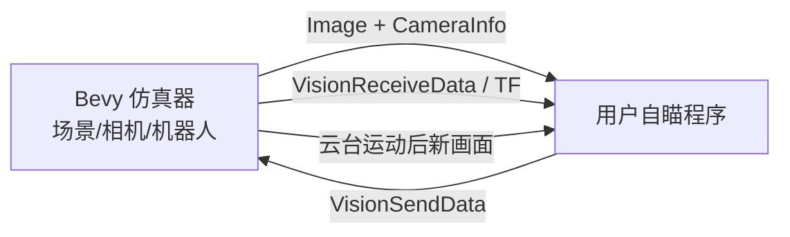

# 接口与架构

## 数据流



用户程序负责识别、目标选择、位姿/弹道解算，以及把自身坐标语义转换成下表的仿真器命令。`frame_id` 只是标识，不会替发送方自动完成 TF 变换。

## 主要话题

| 话题 | 消息 | 方向 | 说明 |
|---|---|---|---|
| `/image_raw` | `sensor_msgs/msg/Image` | 仿真器 → 用户 | 默认 1440×1080、`rgb8`、Reliable |
| `/camera_info` | `sensor_msgs/msg/CameraInfo` | 仿真器 → 用户 | 与当前分辨率和垂直 FOV 配套的内参 |
| `/vision_receive_data` | `rm_interfaces/msg/VisionReceiveData` | 仿真器 → 用户 | 当前 roll/pitch/yaw、弹速等；SensorData QoS |
| `/vision_send_data` | `rm_interfaces/msg/VisionSendData` | 用户 → 仿真器 | 绝对云台姿态与目标状态；SensorData QoS |
| `/tf` | `tf2_msgs/msg/TFMessage` | 仿真器 → 用户 | 坐标关系，使用前核对具体 frame 链 |
| `/simulator/marker` | `visualization_msgs/msg/Marker` | 仿真器 → 调试工具 | 装甲真值，仅辅助调试，不应代替视觉输入 |

默认垂直 FOV 为 45°。1440×1080 时理论零畸变内参约为 `fx=fy=1303.6753, cx=720, cy=540`；程序应以实时 `/camera_info` 为准，不要把这些数值硬编码到其他分辨率或 FOV。

## `VisionSendData` 控制语义

- `yaw`、`pitch`：绝对世界姿态命令，单位为度。基线代码的预期符号是 yaw 左正、pitch 下正，但首次接入必须以小角命令和反馈实测确认。
- `target_state=0` 或 `target_distance=-1.0`：清除当前跟踪目标，停止追踪并保持姿态。
- `target_state=1`：有效目标，不请求开火。
- `target_state=2`：请求开火；基线按上升沿并限频处理，不要假设持续值会持续射击。
- `target_distance`：距离，示例按米发送。
- `delta_yaw`、`delta_pitch`：不是本基线的主要控制量。
- `control_id`：可由发送方递增，便于关联命令与反馈。

仿真器会保存目标角并继续运动，因此“停止发布”不等于“停止追踪”。正常退出、无目标、PnP 失败、图像超时或反馈超时时都要发送无效目标。进程崩溃无法保证退出处理执行，此时用 `F5` 关闭自动控制并观察反馈。

不要把 `/gimbal_pose` 一类占位 `PoseStamped` 当作真实姿态；使用 `/vision_receive_data` 或经核对的 TF。当前时间戳为系统墙钟，不要无依据地开启 `use_sim_time`。

## 两种接入方式

### 直接使用原生消息

推荐生产接入直接订阅图像、内参和反馈，发布 `VisionSendData`。发送方应自己完成：

1. `rgb8` 到算法颜色空间的转换（OpenCV 常用 BGR）。
2. 相机误差到绝对世界姿态的转换。
3. 度/弧度、米/毫米等单位统一。
4. 结果新鲜度、反馈新鲜度和目标有效性检查。
5. 所有异常路径上的明确停止消息。

### 使用最小误差适配器

`examples/ros2_tools/aim_adapter.py` 是可选演示，不是新协议。它订阅 `/aim/error`（`geometry_msgs/msg/Vector3Stamped`）：

- `frame_id=camera_optical_frame`
- `x`：相机画面右正的 yaw 误差，度
- `y`：相机画面上正的 pitch 误差，度
- `z`：目标距离，米
- 时间戳：本次采集时间；重复发布旧时间戳不会续期

适配器默认只启动、不控制。启用方式：

```bash
source scripts/env.sh
python3 examples/ros2_tools/aim_adapter.py \
  --ros-args -p enable_control:=true
```

默认 20 Hz 发布，结果或反馈超过 200 ms 即发停止；单次角度修正限 2°，死区 0.15°。它只示范相机近似对齐云台时的小角度转换，不处理完整外参、TF 或弹道。

## 排错速查

| 现象 | 优先检查 |
|---|---|
| r2r 找不到 ROS 环境/消息头 | 先 `source /opt/ros/humble/setup.bash`，构建并 source `.ros_ws/install/setup.bash`，确认 Clang/libclang |
| 有图像但颜色检测异常 | 消息为 `rgb8`；交给 OpenCV 前转换为 BGR |
| 收不到消息 | topic、消息版本、`ROS_DOMAIN_ID`、QoS、跨机 DDS 网络 |
| 图像延迟累积 | 队列深度设小，只处理最新帧；分开统计接收和处理 FPS |
| 云台不响应 | `F5`、控制话题、是否有另一发布者持续发停止 |
| 越转越偏 | 正负号、度/弧度、绝对角/相对误差、参考系 |
| 振荡或过冲 | 总延迟、命令频率、限幅和死区；不要照搬另一版本 PID |
| 程序退出后仍运动 | 明确发布无效目标；崩溃后用 `F5` 关闭控制 |
| 姿态话题一直为零 | 可能是占位 Pose；改用反馈或核对后的 TF |
| 无窗口/黑屏 | 当前桌面会话、`DISPLAY`/Wayland、Vulkan 驱动和 GPU 设备权限 |
